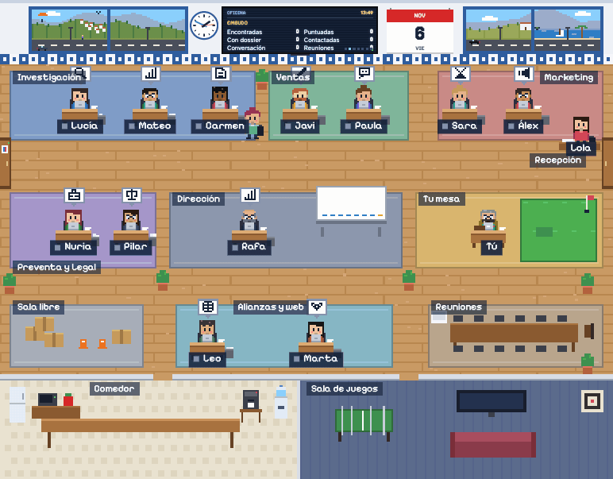

# Oficina de agentes

Una oficina de agentes de IA que busca empresas, las puntúa, prepara dosieres y primeros contactos y te lo deja todo en tu mesa para que tú apruebes, llames y cierres. Lo que se envía a un tercero pasa antes por ti.



Esta copia no lleva datos de ninguna empresa. Los pones tú.

**Contribuciones:** el código es abierto para usarlo, estudiarlo y modificarlo, pero por ahora no aceptamos pull requests ([por qué](CONTRIBUTING.md)). Las incidencias y las ideas sí son bienvenidas.

**Edición Libre** (licencia AGPL-3.0). La edición Pro añade a Lola (recepcionista de voz), la centralita para llamar desde la oficina, los guiones de llamada con método de venta, a Inés para los documentos de clientes, el correo con el diseño de tu empresa, a Rafa vigilando la oficina y el servicio de instalación y soporte: mira [qué cambia entre ediciones](EDICIONES.md).

## Ponerla en marcha

**¿Usas un asistente de IA que trabaja en tu ordenador?** Puedes pedirle: «Lee INSTALAR.md de este repositorio y guíame paso a paso para instalar la oficina. Pregúntame antes de contratar o borrar nada, y las contraseñas las pongo yo».

**¿Nunca has instalado nada en un servidor?** Sigue [INSTALAR.md](INSTALAR.md): explica cada paso, desde contratar el servidor hasta las copias de seguridad.

Si ya manejas Docker, necesitas un servidor con Docker Compose y una clave de IA, de Claude (platform.claude.com) u OpenRouter (openrouter.ai):

```bash
cp .env.example .env     # rellena DB_PASSWORD, PANEL_PASSWORD, PANEL_URL, DOMINIO y CLAVE_CIFRADO
docker compose up -d --build
```

Con `DOMINIO` puesto, Caddy saca el certificado HTTPS solo. Si ya tienes tu propio proxy, borra `COMPOSE_PROFILES=https` de `.env` y apúntalo al puerto 3200 (`Caddyfile.ejemplo` es un modelo). También se puede instalar sin Docker: [más abajo](#instalarla-sin-docker).

## Lo primero: tu IA

La oficina viene vacía: sin empresas, sin contactos y sin datos de nadie. La primera vez que la abres:

1. **Te pide tu clave de IA** (Claude u OpenRouter). Es lo único imprescindible. Se comprueba antes de guardarla y se guarda cifrada.
2. **Con la clave puesta, Rafa te ayuda a configurar el resto** en una conversación: lee tu web, rellena la ficha de la empresa, te propone los departamentos que necesitas, la imagen de marca y el presupuesto, y te pregunta solo lo que falta. Tú corriges y decides cuándo empieza el equipo.

Hasta que termines, nadie más trabaja: solo se gasta lo que consuma esa conversación, unos 30 céntimos. Si lo prefieres, pulsa «Prefiero rellenarlo a mano»: todo está en **☰ Menú › ⚙️ Configuración** y el equipo espera en pausa hasta que pulses «Reanudar».

El presupuesto por defecto es de 50 € al mes. Al llegar, el equipo se pausa solo.

## Después

- **Cuántas empresas buscar.** En «IA: … €» dices cuántas quieres a la semana o al día, y ves lo que costará y los contactos que te dejará en la mesa. Con 0, esta oficina no busca, y puedes subir tu cartera en Empresas › Importar.
- **Rafa es tu gerente.** Dentro de la oficina decide él: ordena tu mesa y el trabajo, marca lo urgente y revisa cómo va todo dos veces al día. Nada sale hacia fuera sin ti.
- **Boletín.** Álex lo prepara cada mes y lo envías con un botón a quien se apuntó con su permiso. Cada correo lleva su enlace de baja. Necesita el correo conectado: mira [CONFIGURACION.md](CONFIGURACION.md).
- **De dónde sale la información.** Búsqueda web, las webs de cada empresa y el Registro Mercantil (BORME), sin clave. Google Maps es opcional, con tu propia clave. Tiene límites sobre qué se puede guardar: están en [CONFIGURACION.md](CONFIGURACION.md).
- **Departamentos a tu medida.** Además de los cinco de siempre, puedes tener los tuyos: por ejemplo, «Atención a pacientes» en una clínica. Rafa te los propone en el primer uso y luego se crean y se cambian en **☰ Menú › ⚙️ Configuración › Departamentos**. Cada uno lleva de 1 a 3 personas, con sus instrucciones y sus permisos, y un tope de gasto al mes (5 € por defecto). Caben 6 encendidos, porque cada uno ocupa una sala. No se conectan a los programas de tu empresa, y lo que preparan pasa por tu mesa.
- [CONFIGURACION.md](CONFIGURACION.md) explica cada servicio opcional: Telegram, correo, LinkedIn, Facebook y el calendario en el móvil.
- [skills/](skills/README.md) contiene las instrucciones de cada agente, en texto normal. Puedes adaptarlas a tu forma de vender.
- `servidor/src/config.js`, bloque `empresa`: textos por defecto que se usan mientras la ficha está vacía, y frases automáticas del bot de contacto.

## Antes de usarla con clientes reales

- **Revisa lo legal con un profesional.** La oficina no envía correos ni WhatsApp comerciales en frío (LSSI, art. 21) y no automatiza LinkedIn, pero el responsable de los datos que guardes y de lo que envíes eres tú. Pilar ayuda a revisar; no sustituye a un abogado.
- **La vida de los personajes es ficción**: sus nombres, familias y anécdotas son inventados y no se envían a nadie.
- **Seguridad:** lee [SECURITY.md](SECURITY.md) (qué protege la oficina, qué tienes que cuidar tú y cómo avisar de un fallo).
- **Haz copias de seguridad** de `data/postgres` y guarda `CLAVE_CIFRADO` en lugar seguro: si cambia, tendrás que volver a pegar las claves del panel.

## Instalarla sin Docker

Necesitas Node 22 o superior y PostgreSQL 16, y ffmpeg si quieres generar vídeos. Desde la carpeta de la oficina:

1. Instala las dependencias:

   ```bash
   cd servidor && npm ci --omit=dev
   ```

2. Crea la base de datos:

   ```bash
   createdb oficina
   ```

3. Copia la configuración:

   ```bash
   cp ../.env.example ../.env
   ```

4. Edita `.env`: quita el `#` de `DATABASE_URL`, inventa `PANEL_PASSWORD` y `CLAVE_CIFRADO`, y pon `PANEL_URL=http://localhost:3000`.

5. Arranca. Node no lee el `.env` por su cuenta: hay que indicárselo así.

   ```bash
   node --env-file=../.env src/index.js
   ```

6. Abre `http://localhost:3000`. La oficina funciona mientras esa ventana siga abierta. Para dejarla siempre encendida en un servidor, usa un gestor de procesos (systemd o pm2) y pon delante un proxy con HTTPS: tienes un ejemplo en `Caddyfile.ejemplo`.
